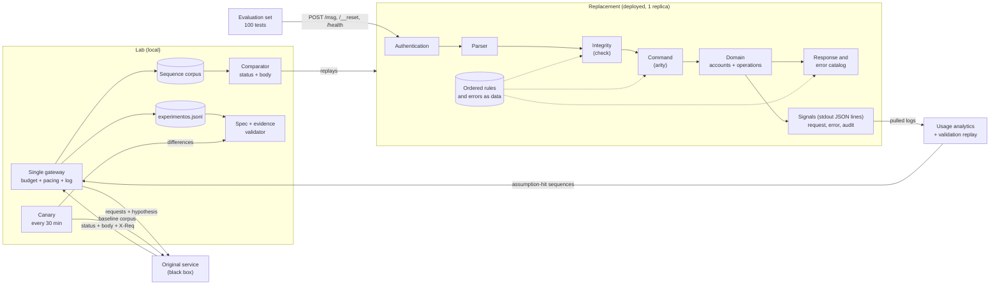

# Systems Design · Challenge 2, The Black Box

Frontier BOG/26 · architecture diagram in section 2 (Mermaid)

## 1. Problem and constraints
A legacy HTTP service with no source code and no documentation receives `POST /msg` with `{"m":"COMMAND;arg;…;check"}`, keeps state between requests and is reset with `POST /__reset`. We must build a replacement that answers **identically in status and body** (headers are not compared), in under 5 s per step, against 100 hidden tests of 1 to 12 requests each.

| Constraint | Design consequence |
|---|---|
| The replacement may not call the original at runtime | Every behavior is learned offline and encoded |
| 10 req/s and 8,000 req/day per token | Exploration is planned as a budget |
| The test set talks to a single process | One instance with in-memory state, no serverless |
| The service may change during the day | Continuous change detection and rules as data |
| A false claim in the spec subtracts points | All traffic to the original is logged with its hypothesis |

**What we know today** (20 examples from the morning version): protocol `COMMAND;args;check`, commands `PING ALTA CONSULTA DEPOSITO TRANSFER ANULA`, error families `E2xx` integrity, `E3xx` command, `E4xx` resource and `E5xx` business, counters `AC-0001` and `OP-0001`, and response quirks (`recieved`, `cuentaId` versus `cuenta_id`) that must be reproduced verbatim. **What we do not know**: the check field function, the order in which errors are evaluated, and the behavior without a token.

## 2. Architecture
Two parts that share no runtime code:

- **Replacement** (deployed, one replica): `HTTP → authentication → parser → integrity → command → domain → response catalog`. Validation rules are an ordered list and errors are a catalog (code, status, message): data, not code, so they can change in minutes.
- **Lab** (local, not deployed): a single **gateway** to the original that enforces budget and pacing and refuses to send without a hypothesis; a **corpus** of recorded sequences; a **comparator** that applies the same criterion as the test set (status and body); a **canary** that replays a small corpus against the original every 30 minutes; and a **spec validator** that checks every claim cites existing log lines.

## 3. Data flow
1. The gateway sends a sequence to the original (after `__reset`), writes each request to `experimentos.jsonl` and updates the corpus.
2. The comparator replays the corpus against the local replacement; any difference is a defect or a new hypothesis.
3. Each confirmed behavior enters the spec with its evidence and confidence.
4. The canary compares against the baseline corpus: a difference is a service change and is recorded under "Changes during the day".
5. Each `/evento` validation leaves a request log; its assumption hits feed the validation replay loop (section 4).

## 4. Observability, audit and usage
The replacement may not add routes (every other path must answer like the original), so all signals leave as **JSON lines on stdout**, which the platform keeps and the lab pulls. Tokens are never logged.

| Signal | Content | Used for |
|---|---|---|
| Request log | One line per request: request id, time, method, path, auth outcome, raw input, status, response, latency, matched rule | Diagnose hidden-test failures; `/evento` only shows a pass count |
| Error log | Error code and the rule that produced it; unhandled exceptions with stack (the client still gets a valid response shape); `assumption_hit` with the spec assumption id when a default was used | First place to look after a failed validation |
| Audit log | Append-only state mutations (reset, account created, deposit, transfer, cancellation) with balances before and after | Rebuild any sequence's state, check transitions against the spec, explain behavior in the debrief |
| Usage analytics | Computed offline from the request log: command and error-code frequency, latency p50/p95/max, test shapes (segments between resets), assumption hit rate | Know what the hidden set exercises and where assumptions are used |

On the lab side, `experimentos.jsonl` plus the daily budget counter are the audit of everything asked of the original.

**Validation replay loop**: after each `/evento` run, extract the sequences that hit an assumption, replay them against the original through the gateway (budgeted) and diff. Each mismatch is a failing class of hidden tests to fix as a class, never as a hardcoded case. It only works before 20:00, when participant tokens stop working on the original.

## 5. Decisions and discarded alternatives
| Decision | Discarded | Why |
|---|---|---|
| Deterministic state machine in TypeScript, no LLM | LLM imitating responses | Comparison is exact character by character; an LLM adds latency and nondeterminism |
| One instance, in-memory state | Database, multiple replicas | The test set talks to one process and reset is cheap; every extra piece is a failure point |
| Rules and errors as ordered data | Conditionals in code | Evaluation order and message texts are the most likely things to change |
| Single gateway with automatic log | Loose `curl` and scripts | The log is graded and the budget is limited |
| Derive the check function with one-character probes | Guess from the samples we already have | Common functions were tried against the available samples and none matches |
| Always-on single-replica hosting (Railway or Fly.io) | Serverless | State must live in one process |
| Signals as JSON lines on stdout, analyzed offline | A `/__stats` endpoint, an external monitoring service | Extra routes would break "every other path answers like the original"; each service is one more moving part |

## 6. Failure modes
| Failure | Mitigation |
|---|---|
| We do not derive the check function in time | Cap of 1,500 requests; fallback: table of known checks plus accept any numeric check (recorded as **assumption**) |
| We exhaust the budget | Counter in the gateway, fixed reserve for the incident |
| The service changes at 15:30 | Canary every 30 min, rules as data, one-command deploy and rollback |
| Near-identical bodies (accents, trailing spaces) | Strict comparator, catalog copied from real responses |
| The platform restarts or duplicates the instance | One replica, `/health`, correct initial state on boot |
| Slow response | No external dependencies, answers from memory |
| Hidden tests fail and we cannot see why | Request, error and audit logs; validation replay loop on assumption hits |

## 7. Plan to measure
The oracle is the experiment log: each line is a test case with its real response.

| Metric | Target |
|---|---|
| Corpus lines reproduced exactly by the replacement | 100% before every deploy |
| `/evento` tests passing (out of 100) | > 75 at close; tracked per validation |
| Spec behaviors with valid evidence | 100%; none without a log line |
| Canary differences against the baseline corpus | 0 at start; each one classified |

Concrete cases from day one: the 20 examples in order (20/20); invalid and malformed check; unknown command; wrong arity; transfer limit at the boundary; `ANULA` twice; nonexistent account; insufficient balance; request without token.

## 8. Current state and acknowledged gaps
Honest status at 10:43 COT. "Verified" means exercised against a local fake of the service, not against the real one.

| Component | Status | Verification | Known gap |
|---|---|---|---|
| Gateway `scripts/bb.sh` | Built | Log line, budget counter and rate-limit handling checked against a local fake | Not run against the real service yet; unauthenticated requests may or may not count against the quota |
| Replay and comparator `scripts/smoke.sh` | Built | 20/20 on the morning examples against a fake; a single wrong body is reported with want and got | Number formatting (`1` versus `1.0`) is not guaranteed to be compared as strictly as the judge does |
| Corpus `tests/corpus` | 1 sequence, the 20 morning examples | Taken verbatim from the organizers' file | Covers none of the error orderings, auth, or long sequences yet |
| Canary, spec validator | Designed, not built | None | Needed before 15:30 |
| Replacement | Not started (design phase) | None | Hosting target undecided |
| Signals (request, error, audit) | Designed, not built | None | None of the analytics exist until the replacement does |

**Acknowledged gaps**
- The check-field function is unknown. Common functions (sums, weighted sums, xor, crc, polynomial hashes) were tried against the 14 usable samples and none matched. Without it the replacement cannot accept any valid message, so it is the first exploration target and the highest risk.
- Two behaviors are ambiguous in the examples: whether the transfer limit is per operation or cumulative, and whether a cancellation refunds the origin account.
- We have not yet confirmed that the service still matches the morning version; the first replay of the corpus against the original answers that.
- The experiment log carries three extra fields (`method`, `path`, `auth`) beyond the organizers' format, needed to interpret non-`/msg` requests; they can be stripped at submission.
- This document exceeds one printed page and must be trimmed for the submission.

## 9. Execution plan
**Exploration budget** (8,000 req/day):

| Block | Requests |
|---|---|
| Replay the 20 examples and the baseline corpus | 40 |
| HTTP surface: auth, methods, routes, invalid bodies | 150 |
| Check function | 1,500 |
| Commands, arity, amounts, errors and their order | 2,500 |
| State: limits, cancellations, counters, long sequences | 1,500 |
| Canary (40 requests every 30 min) | 720 |
| Validation replay (sequences that hit an assumption) | 500 |
| Reserve for the 15:30 change | 1,000 |

**Schedule** (COT):

| Time | Milestone |
|---|---|
| 12:00–13:00 | Gateway, baseline corpus, HTTP surface, first check-function probes |
| 13:30 | Minimal replacement deployed and validated on `/evento` |
| 13:30–15:30 | Check function, commands, errors and state; spec in parallel |
| 15:30 | Service change: canary, diff, minimal change, document it |
| 15:30–19:00 | Edge cases and spec; no redesign |
| 19:00 | Freeze: fixes only |
| 19:30 | Video recorded |
| 20:00 | Final validation from a tagged commit |

## 10. What we cut
No UI, no database, no LLM in the replacement, no multiple instances, no spec polish before behaviors are confirmed. If we fall behind, cut in this order: unlikely edge cases, spec polish, higher canary frequency. Never the entrypoint contract, the log, or the truthfulness of the spec.
