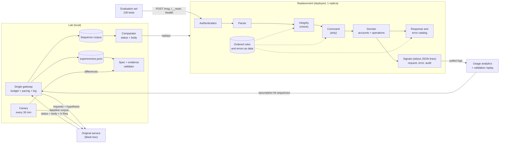

# Systems Design · Challenge 2, The Black Box

Frontier BOG/26 · architecture diagram in section 2 (Mermaid)

## 1. Problem and constraints
A legacy HTTP service with no source code and no documentation receives `POST /msg` with `{"m":"COMMAND;arg;…;check"}`, keeps state between requests and is reset with `POST /__reset`. We must build a replacement that answers **identically in status and body** (headers are not compared), in under 5 s per step, against 100 hidden tests of 1 to 12 requests each.

| Constraint | Design consequence |
|---|---|
| The replacement may not call the original at runtime | Every behavior is learned offline and encoded |
| 10 req/s and 8,000 req/day per token | Exploration is planned as a budget |
| The test set talks to a single process | One instance with in-memory state, no serverless |
| The service may change during the day | Continuous change detection and rules as data |
| A false claim in the spec subtracts points | All traffic to the original is logged with its hypothesis |

**Where this ended up** (see sections 8 and 9): the protocol is `COMMAND;args;check` over `POST /msg`; the check is a mod-97 value derived from the message; the evaluation order of every error was probed pair by pair; the service changed at 15:30 (balances as strings, transfer limit lowered). The at-design-time unknowns (check function, error order, behavior without a token) are all resolved; the open points are listed in section 8.

## 2. Architecture
Two parts that share no runtime code:

- **Replacement** (deployed, one replica): `HTTP → authentication → parser → integrity → command → domain → response catalog`. Validation rules are an ordered list and errors are a catalog (code, status, message): data, not code, so they can change in minutes.
- **Lab** (local, not deployed): a single **gateway** to the original that enforces budget and pacing and refuses to send without a hypothesis; a **corpus** of recorded sequences; a **comparator** that applies the same criterion as the test set (status and body); a **canary** that replays a small corpus against the original every 30 minutes; and a **spec validator** that checks every claim cites existing log lines.

## 3. Data flow
1. The gateway sends a sequence to the original (after `__reset`), writes each request to `experimentos.jsonl` and updates the corpus.
2. The comparator replays the corpus against the local replacement; any difference is a defect or a new hypothesis.
3. Each confirmed behavior enters the spec with its evidence and confidence.
4. Change detection: replaying the recorded corpus against the original (`smoke.sh --original`) shows a service change as a difference, recorded under "Changes during the day". This was run by hand, not on a schedule (no unattended canary was built).
5. Each `/evento` validation leaves a request log. The validation replay loop of section 4 was designed but not executed.

## 4. Observability, audit and usage
The replacement may not add routes (every other path must answer like the original), so all signals leave as **JSON lines on stdout**, which the platform keeps and the lab pulls. Tokens are never logged.

| Signal | Content | Used for |
|---|---|---|
| Request log | One line per request: request id, time, method, path, auth outcome, raw input, status, response, latency, matched rule | Diagnose hidden-test failures; `/evento` only shows a pass count |
| Error log | Error code and the rule that produced it; unhandled exceptions with stack (the client still gets a valid response shape); `assumption_hit` with the spec assumption id when a default was used | First place to look after a failed validation |
| Audit log | Append-only state mutations (reset, account created, deposit, transfer, cancellation) with balances before and after | Rebuild any sequence's state, check transitions against the spec, explain behavior in the debrief |
| Usage analytics | Computed offline from the request log: command and error-code frequency, latency p50/p95/max, test shapes (segments between resets), assumption hit rate | Know what the hidden set exercises and where assumptions are used |

**Implemented**: the request, error, audit and `assumption_hit` lines (`src/core/server.ts`, `src/profile/blackbox/`). The audit lines carry the operation, the accounts and the amount, not the balances before and after. **Not built**: the usage analytics and the validation replay loop.

On the lab side, `experimentos.jsonl` plus the daily budget counter are the audit of everything asked of the original.

**Validation replay loop**: after each `/evento` run, extract the sequences that hit an assumption, replay them against the original through the gateway (budgeted) and diff. Each mismatch is a failing class of hidden tests to fix as a class, never as a hardcoded case. It only works before 20:00, when participant tokens stop working on the original.

## 5. Decisions and discarded alternatives
| Decision | Discarded | Why |
|---|---|---|
| Deterministic state machine in TypeScript, no LLM | LLM imitating responses | Comparison is exact character by character; an LLM adds latency and nondeterminism |
| One instance, in-memory state | Database, multiple replicas | The test set talks to one process and reset is cheap; every extra piece is a failure point |
| Commands as a table of `{arity, run}` and errors as a catalog; request-level order as one function | A framework or a rules DSL | Message texts and per-command rules change in one place; the evaluation order lives in `handleMessage` and was the part that needed fixing most often |
| Single gateway with automatic log | Loose `curl` and scripts | The log is graded and the budget is limited |
| Derive the check function with one-character probes | Guess from the samples we already have | Common functions were tried against the available samples and none matches |
| Railway, one always-on replica, built from the Dockerfile | Fly.io (defaults to two machines and scale-to-zero), serverless | State must live in one process |
| Signals as JSON lines on stdout, analyzed offline | A `/__stats` endpoint, an external monitoring service | Extra routes would break "every other path answers like the original"; each service is one more moving part |

## 6. Failure modes
| Failure | Mitigation |
|---|---|
| We do not derive the check function in time | Cap of 1,500 requests (about 150 were used); fallback was a table of known checks plus accepting any numeric check, never needed |
| We exhaust the budget | Counter in the gateway, fixed reserve for the incident |
| The service changes at 15:30 | Canary every 30 min, rules as data, one-command deploy and rollback |
| Near-identical bodies (accents, trailing spaces) | Strict comparator, catalog copied from real responses |
| The platform restarts or duplicates the instance | One replica, `/health`, correct initial state on boot |
| Slow response | No external dependencies, answers from memory |
| Hidden tests fail and we cannot see why | Request, error and audit logs; validation replay loop on assumption hits |

## 7. Plan to measure
The oracle is the experiment log: each line is a test case with its real response.

| Metric | Target |
|---|---|
| Corpus lines reproduced exactly by the replacement | 100% before every deploy |
| `/evento` tests passing (out of 100) | > 75 at close; tracked per validation |
| Spec behaviors with valid evidence | 100%; none without a log line |
| Canary differences against the baseline corpus | 0 at start; each one classified |

Concrete cases from day one: the 20 examples in order (20/20); invalid and malformed check; unknown command; wrong arity; transfer limit at the boundary; `ANULA` twice; nonexistent account; insufficient balance; request without token.

## 8. Current state and acknowledged gaps
Final state of the implementation. "Verified" means replayed against the real service through the gateway unless stated otherwise.

| Component | Status | Verification |
|---|---|---|
| Gateway `scripts/bb.sh` | Built, used for every request to the original (580 logged) | Real service; daily budget guard and rate-limit handling |
| Replay and comparator `scripts/smoke.sh` | Built | 297/297 against the v2 recording, local and deployed; `--original` found the v2 changes |
| Corpus `tests/corpus` | v2 recording (297 requests, 46 sequences) and the v1 recordings kept apart in `v1/` | Cut from the experiment log, never typed by hand |
| Replacement `src/` | Built and deployed on Railway | Matches every observed behavior; hidden set run 1 of 3 used |
| Specification `docs/spec.md` | Generated from the log by `scripts/build-spec.py` | Every cited id exists; every confirmed behavior has two or more lines |
| Signals (request, error, audit, assumption) | Built | JSON lines on stdout; no token is ever logged |
| Canary, usage analytics, validation replay loop | Not built | Change detection was done by hand |

**Acknowledged gaps**
- The third v2 change is not identified. Amount validation (`E303`) and the same-account rule (`E304`) are the candidates, but version 1 never exercised them, so they cannot be shown to be new.
- The amount cap is assumed to be 10 digits: 9,999,999,999 is accepted and 99,999,999,999 is rejected; values between were not bisected.
- Never probed: an unauthenticated unknown route, `POST /health`, oversized bodies, a control with leading zeros (`062`), and characters other than letters, digits, space and `é` inside names.
- The replacement keeps one global state; the original keeps state per token. Equivalent for the evaluator, which uses one token.
- The experiment log submitted (`submission/experimentos.jsonl`) drops the `method`, `path` and `auth` fields kept in `lab/`, so non-`/msg` requests are identified only by their hypothesis text.
- The v2 change was detected at about 17:15, not at 15:30 when the ticket opened: the plan assumed an unattended canary that was never built.

## 9. Execution plan
**Exploration budget** (8,000 req/day):

| Block | Requests |
|---|---|
| Replay the 20 examples and the baseline corpus | 40 |
| HTTP surface: auth, methods, routes, invalid bodies | 150 |
| Check function | 1,500 |
| Commands, arity, amounts, errors and their order | 2,500 |
| State: limits, cancellations, counters, long sequences | 1,500 |
| Canary (40 requests every 30 min) | 720 |
| Validation replay (sequences that hit an assumption) | 500 |
| Reserve for the 15:30 change | 1,000 |

**Planned versus actual** (COT):

| Planned | Planned time | Actual (only what the logs and platform timestamps show) |
|---|---|---|
| Gateway, baseline corpus, first check probes | 12:00-13:00 | Gateway and replay scripts written 10:17-10:19; check function derived before 17:15 (exact time not recorded) |
| Minimal replacement deployed and validated | 13:30 | Platform validation passed 18:08 (run 1 of 3), after fixing the team token; the running build was deployed 17:57 |
| Service change absorbed | 15:30-16:30 | Ticket opened 15:30; replay of the v1 recording run at about 17:15; absorbed before the 18:08 validation |
| Freeze | 19:00 | Not formally applied |
| Final validation from a tagged commit | 20:00 | Pending |

Budget actually used: 580 of 8,000 requests. The reserve was never needed because the check function was derived from about 150 requests.

## 10. What we cut
No UI, no database, no LLM in the replacement, no multiple instances, no spec polish before behaviors are confirmed. If we fall behind, cut in this order: unlikely edge cases, spec polish, higher canary frequency. Never the entrypoint contract, the log, or the truthfulness of the spec.
